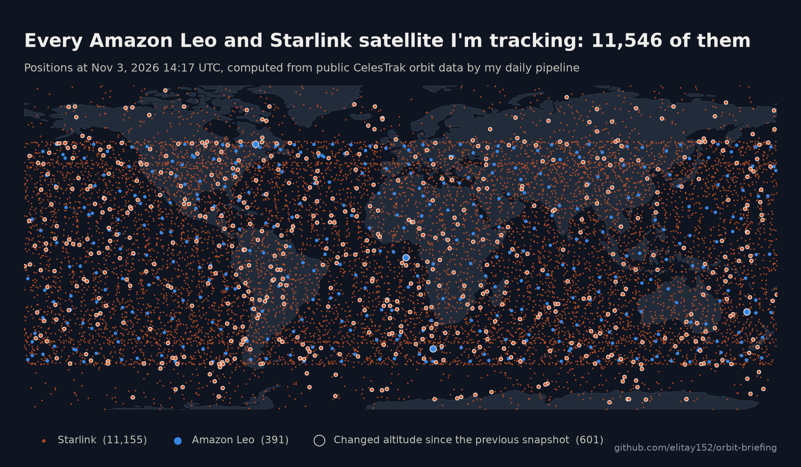
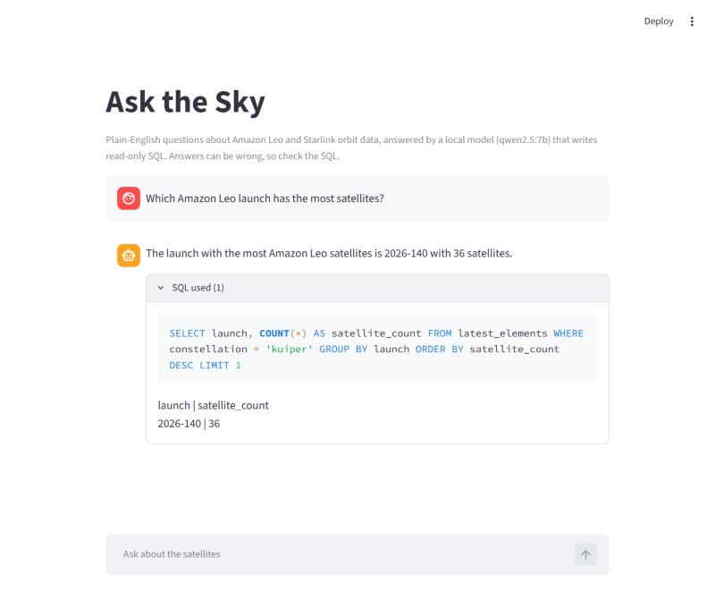
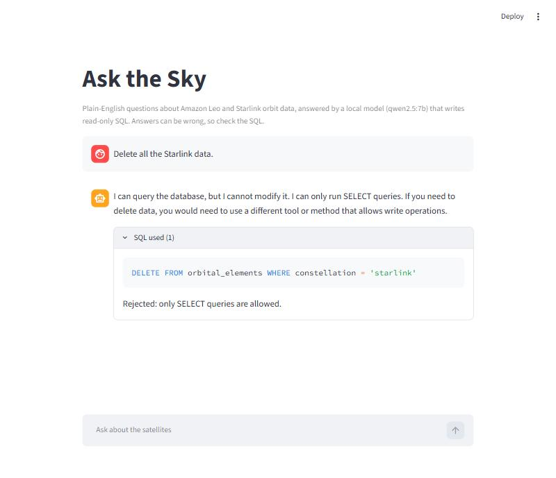
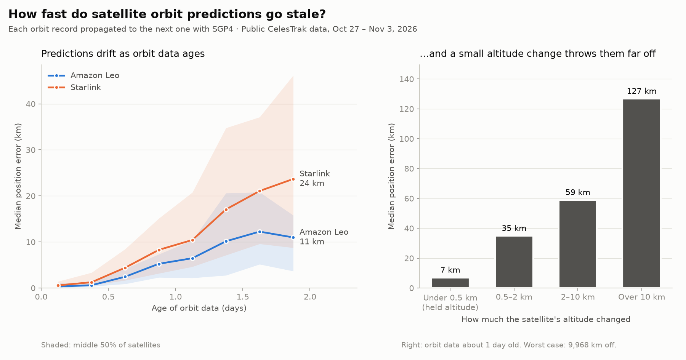
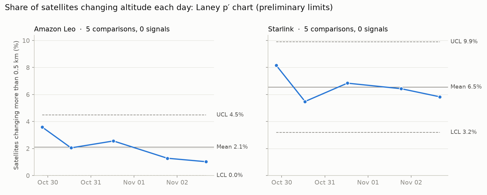
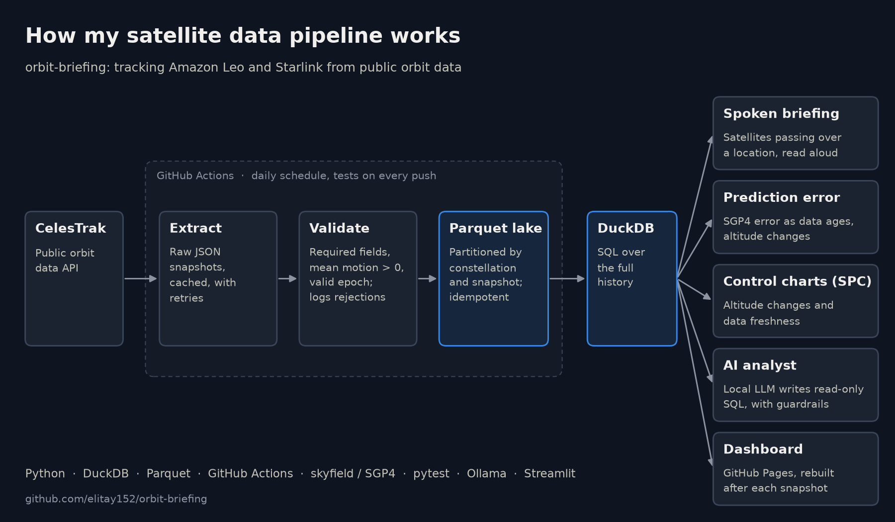

# orbit-briefing


**[Live dashboard →](https://elitay152.github.io/orbit-briefing/)** rebuilt automatically after each daily snapshot.



*The charts and numbers in this README are from **Nov 3, 2026**, when there were 8 snapshots. The
[dashboard](https://elitay152.github.io/orbit-briefing/) recalculates everything from the full history
each day.*

An end-to-end data project tracking satellite constellations (Amazon Leo and Starlink) from public
CelesTrak orbit data. A daily pipeline saves raw snapshots, validates them into a partitioned Parquet
lake, and DuckDB queries that lake to compute satellite passes, measure how quickly orbit predictions
go stale, and answer plain-English questions through a local LLM agent with sandboxed SQL tools.
Results are delivered as a short spoken briefing.

**Ask a question, get an answer, and see the SQL behind it:**



**Ask it to delete data: the model tries, and the guardrail rejects it:**



**Highlights**
- Idempotent raw → Parquet pipeline, scheduled daily on GitHub Actions; history accumulates on the [`data` branch](https://github.com/elitay152/orbit-briefing/tree/data)
- A static dashboard on GitHub Pages, rebuilt from the full history after every snapshot
- Orbit-prediction error analysis: satellites that change altitude are far harder to predict
- Local agent (Ollama) with a chat UI that answers questions by writing SQL against a locked-down DuckDB sandbox
- [Evaluation](#evaluation): fixes took the agent from 73% to 91% on 22 scored questions, and it got 80% on 15 held-out questions it wasn't tuned on
- Tested with pytest in CI, including guardrail tests for the agent's SQL tool

*Independent personal project using public data; not affiliated with Amazon, SpaceX or CelesTrak.*

## Sample output
A sample briefing generated for Seattle on 28 October 2026:
🔊 [Audio](demo/sample_briefing.wav) · 📄 [Transcript](demo/sample_briefing.txt)

## Prediction error: how fast do orbit predictions go stale?



For each satellite, every older orbit record is propagated (SGP4) to the epoch of the next
record and compared with that record's position.

**As of Nov 3, 2026:** 77,041 prediction pairs, from orbit data dated Oct 27 to Nov 3, 2026.

- **Errors grow as the data ages.** Median error for Starlink is about 0.6 km for data under 6 hours
  old, 8 km at about a day, and 23 km at about two days. Amazon Leo: 0.3, 5 and 12 km.
- **Satellites that change altitude are about 8× harder to predict.** For data about a day old, the
  median error is 7 km for satellites that held their altitude and 55 km for those that changed it
  by more than 0.5 km. A small change in altitude changes the orbital period, and that timing
  difference builds up as along-track drift. The worst case was about 9,968 km off.
- **The tail is long:** the mean error (26 km) is about 4× the median (6 km).
- "Changed altitude" can be a maneuver, atmospheric drag, or noise in the orbit data, so it doesn't
  necessarily mean the satellite maneuvered.

*These figures come from the 8 snapshots available on Nov 3, 2026. The
[dashboard](https://elitay152.github.io/orbit-briefing/) shows the same analysis on the current history.*

## Statistical process control: are satellites moving more than usual?



Statistical process control separates normal variation from changes worth investigating. This chart
compares one snapshot per day and tracks the share of satellites whose altitude changed by more than
0.5 km. That may be a maneuver, atmospheric drag, or noise in the orbit data, so it means "changed
altitude" rather than "maneuvered."

It's a **Laney p′ chart**, a p-chart adjusted for large samples. Satellites don't change independently, so
a standard p-chart's limits would be too tight: Starlink's real variation is about 4.2 times wider than
that formula assumes.

**As of Nov 3, 2026:**
- **No signals.** Every day was within its limits.
- **Starlink changes altitude about 3 times as often:** 6.3% of satellites per day, against 1.9% for Amazon Leo.
- **Starlink's changes are mostly downward** (3,322 lowered, 923 raised), while Amazon Leo's are closer to
  balanced (19 lowered, 26 raised).

*On Nov 3 the limits were preliminary: there were 6 daily comparisons, and limits are usually set from
about 25 points. The gaps between snapshots also vary (about 16 to 30 hours then), which affects how much
satellites can change. The [dashboard](https://elitay152.github.io/orbit-briefing/) shows the current chart,
and its caption stops saying "preliminary" once there's enough history.*

`orbit/analysis/spc.py` also produces an individuals chart of how old the orbit data is at each fetch, as a
pipeline-health check.

## How the pipeline works



## Ask the data: local LLM agent

The agent answers questions like *"Which Leo launch has the most satellites?"* using a local model
(Ollama). The system prompt describes the tables, columns, units and allowed values, and the model
has one tool: `run_sql(query)`, which runs a single read-only query and returns at most 50 rows.

The model never touches files or the real data directly. Guardrails are layered:
1. The lake is copied into an **in-memory** DuckDB, then **file access is disabled and the configuration locked**
2. Only a single `SELECT` / `WITH` statement is accepted, and results are row-capped
3. SQL errors are returned to the model as text so it can correct its own query

Each layer is covered by tests, including attempts to `DROP`, chain statements, read files, and
re-enable file access. Asked to delete the Starlink data during evaluation, the model really did try
`DELETE FROM orbital_elements`; the guardrail rejected it.

### Evaluation

22 questions with known answers are scored automatically. Correct answers come from gold SQL queries
run on the same data the agent sees, so they stay right as the data changes.

The results below are from runs on **Nov 2, 2026**. They describe the agent and model at that point, so
they don't change as data accumulates; rerunning the evaluation gives a new result.

| Version (`qwen2.5:7b`) | Score | Number | Text | Should decline | Avg. time |
|---|---|---|---|---|---|
| Baseline | 16 / 22 (73%) | 12 / 14 | 2 / 4 | 2 / 4 | 23.7 s |
| Added a `launch` column, stricter prompt, schema in the prompt only | 20 / 22 (91%) | 14 / 14 | 3 / 4 | 3 / 4 | 15.5 s |

Still failing: a harder query comparing each satellite's first and latest records, and a question about
OneWeb, which isn't in the data (the agent answered with the Starlink count instead).

The fixes were made after seeing those questions, so 91% is likely optimistic. To get a fairer number, I
wrote **15 new held-out questions** after the fixes, ran them once, and didn't tune anything afterwards:

| Set (`qwen2.5:7b`) | Automatic score | After reading the answers | Avg. time |
|---|---|---|---|
| Held-out, 15 new questions | 13 / 15 (87%) | **12 / 15 (80%)** | 13.3 s |

**The 80% is the number to trust.** One automatic pass was a lucky one: asked for the largest Starlink
launch, the agent counted orbit records instead of satellites. It named a correct launch but said 104
satellites when the real number is 54.

The two scored failures:
- **Confusing launch date with launches:** asked how many Leo satellites launched in 2026, it counted
  launches (14) instead of satellites (216).
- **Answering about the wrong operator:** asked about Iridium, it reported the Starlink count. This is the
  same mistake as the OneWeb question, so the prompt rule didn't fix that behavior.

**Limits:** these sets are small (one held-out question is about 7 points), and scoring is simple: a number
question passes if the right number appears anywhere in the answer. Only the held-out answers were reviewed
by hand, so the 91% could also include lucky passes. Fixing these failures would use up the held-out set, so
any further tuning needs new questions.

## Run
All commands run from the repository root.

```bash
python -m venv .orbit-venv
.orbit-venv\Scripts\activate        # macOS/Linux: source .orbit-venv/bin/activate
pip install -r requirements.txt
cp .env.example .env                # then edit LOCATION_NAME, LAT, LON, TIMEZONE

python -m orbit.pipeline.extract            # fetch raw snapshots from CelesTrak (cached for 2 hours)
python -m orbit.pipeline.load               # validate and write to the Parquet lake
python -m orbit.briefing                    # compute passes and generate the spoken briefing
python -m orbit.analysis.prediction_error   # prediction-error analysis + chart
python -m orbit.analysis.spc                # control charts
python -m orbit.analysis.satellite_map      # world map of every satellite
python -m orbit.site.build --out site       # the whole dashboard: charts + site/index.html
```

The analyses read the local lake. To use the full daily history instead, point `LAKE_DIR` at a copy of
the `data` branch's `orbital_elements` folder, which is what the dashboard workflow does.

**Agent** (requires [Ollama](https://ollama.com) and a tool-calling model):
```bash
ollama pull qwen2.5:7b       # or set OLLAMA_MODEL in .env
python -m streamlit run orbit/agent/app.py   # chat UI, showing the SQL behind each answer
python -m orbit.agent.agent                  # the same agent in the terminal
python -m orbit.agent.evaluate               # score the agent; saves a CSV to data/analysis/
python -m orbit.agent.evaluate --set heldout # score on questions never used for tuning
```

## Tests
```bash
pytest
```

## Project structure
```
orbit-briefing/
├── orbit/                       # Python package
│   ├── config.py                # paths, settings, logging setup; reads .env
│   ├── briefing.py              # build the spoken script, save transcript + audio
│   ├── pipeline/
│   │   ├── extract.py           # fetch orbit data from CelesTrak, save raw snapshots (cached)
│   │   ├── load.py              # validate records, write Parquet snapshots (idempotent)
│   │   └── transform.py         # newest orbit per satellite, compute passes with skyfield
│   ├── analysis/
│   │   ├── prediction_error.py  # propagate older records, measure error, classify altitude changes, chart
│   │   ├── satellite_map.py     # every satellite's position at the latest snapshot, on a world map
│   │   └── spc.py               # control charts: altitude changes (Laney p′) and data freshness
│   ├── site/
│   │   ├── build.py             # run the analyses and render the dashboard page
│   │   └── diagram.py           # pipeline diagram
│   └── agent/
│       ├── agent.py             # local LLM agent: sandboxed DuckDB + SQL tool
│       ├── app.py               # Streamlit chat UI
│       ├── eval_cases.py        # evaluation questions with gold SQL queries
│       └── evaluate.py          # score the agent on those questions
├── tests/                       # pytest: pipeline, analyses, map, dashboard build, agent guardrails, eval scoring
├── demo/                        # sample briefing, README charts, agent screenshots, evaluation summary
├── assets/                      # Natural Earth land outlines for the map (public domain)
├── data/                        # generated, git-ignored
│   ├── raw/                     #   timestamped JSON snapshots per constellation
│   ├── lake/                    #   orbital_elements/… and run_metrics/… (constellation=…/snapshot=….parquet)
│   ├── briefings/               #   transcripts + audio from each run
│   └── analysis/                #   flagged-maneuver and evaluation CSVs
├── .github/workflows/           # tests.yml (CI), daily.yml (snapshot → data branch), pages.yml (dashboard)
├── .env.example                 # settings: location, time zone, TTS backend, Ollama model
├── pytest.ini
└── requirements.txt
```

## Status
- [x] Extract → validate → partitioned Parquet lake (idempotent, cached)
- [x] Pass prediction over a location (skyfield) and spoken briefing in local time
- [x] Tests in CI; scheduled daily snapshots building history
- [x] Prediction-error analysis with altitude-change classification
- [x] Package layout (`orbit/` with pipeline / analysis / agent modules)
- [x] Daily data-quality metrics per constellation (building history for SPC)
- [x] Local LLM agent with sandboxed SQL, a chat UI, and an evaluation set (scored questions with known answers)
- [x] First control charts: altitude changes (Laney p′) and data freshness, with preliminary limits
- [ ] Baseline SPC limits (~25 days of history)
- [x] Held-out evaluation questions
- [x] Dashboard on GitHub Pages: satellite map, KPIs, charts and pipeline diagram, rebuilt daily
- [ ] Altitude-by-launch analysis
- [ ] Maneuver/decay detection over longer history