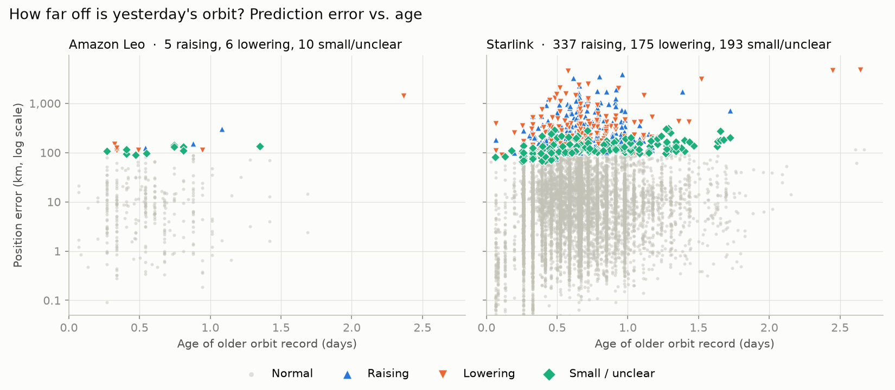

# orbit-briefing


An end-to-end data project tracking satellite constellations (Amazon Leo and Starlink) from public
CelesTrak orbit data. A daily pipeline saves raw snapshots, validates them into a partitioned Parquet
lake, and DuckDB queries that lake to compute satellite passes, measure how quickly orbit predictions
go stale, and answer plain-English questions through a local LLM agent with sandboxed SQL tools.
Results are delivered as a short spoken briefing.

**Highlights**
- Idempotent raw → Parquet pipeline, scheduled daily on GitHub Actions; history accumulates on the [`data` branch](https://github.com/elitay152/orbit-briefing/tree/data)
- Orbit-prediction error analysis with maneuver detection (raising / lowering)
- Local agent (Ollama) that answers questions by writing SQL against a locked-down DuckDB sandbox
- Tested with pytest in CI, including guardrail tests for the agent's SQL tool

## Sample output
A sample briefing generated for Seattle on 28 October 2026:
🔊 [Audio](demo/sample_briefing.wav) · 📄 [Transcript](demo/sample_briefing.txt)

## Prediction error: how fast do orbit predictions go stale?



For each satellite, every older orbit record is propagated (SGP4) to the epoch of the next
record and compared with that record's position.

- **Typical error is ~7–10 km** for records up to a day apart, similar for Amazon Leo and Starlink,
  and grows with age (Starlink median: 6.7 → 9.7 → 12.6 km at ~0, 1, 2 days).
- **The tail is long:** mean error is 2–4× the median, driven by satellites that maneuvered.
  Altitude changes of only 10–27 km produced position errors of thousands of kilometers, because
  a small change in orbital period accumulates as along-track drift.
- **Flagging** pairs above 10× their age-bucket median and labeling by altitude change finds
  337 raising / 175 lowering maneuvers in Starlink and 5 / 6 in Amazon Leo over the first few days of data.
- Vertical bands in the Starlink cloud reflect the **batch cadence** of orbit-data updates.

*Based on a few days of snapshots; the daily job keeps extending the history.*

## Ask the data: local LLM agent

The agent answers questions like *"Which Leo launch has the most satellites?"* using a local model
(Ollama) that calls two tools:

- `describe_schema()` explains the tables, columns, units and allowed values
- `run_sql(query)` runs a single read-only query and returns at most 50 rows

The model never touches files or the real data directly. Guardrails are layered:
1. The lake is copied into an **in-memory** DuckDB, then **file access is disabled and the configuration locked**
2. Only a single `SELECT` / `WITH` statement is accepted, and results are row-capped
3. SQL errors are returned to the model as text so it can correct its own query

Each layer is covered by tests, including attempts to `DROP`, chain statements, read files, and
re-enable file access.

## Run
All commands run from the repository root.

```bash
python -m venv .orbit-venv
.orbit-venv\Scripts\activate        # macOS/Linux: source .orbit-venv/bin/activate
pip install -r requirements.txt
cp .env.example .env                # then edit LOCATION_NAME, LAT, LON, TIMEZONE

python -m orbit.pipeline.extract            # fetch raw snapshots from CelesTrak (cached for 2 hours)
python -m orbit.pipeline.load               # validate and write to the Parquet lake
python -m orbit.briefing                    # compute passes and generate the spoken briefing
python -m orbit.analysis.prediction_error   # prediction-error analysis + chart
```

**Agent** (requires [Ollama](https://ollama.com) and a tool-calling model):
```bash
ollama pull qwen2.5:7b       # or set OLLAMA_MODEL in .env
python -m orbit.agent.agent
```

## Tests
```bash
pytest
```

## Project structure
```
orbit-briefing/
├── orbit/                       # Python package
│   ├── config.py                # paths, settings, logging setup; reads .env
│   ├── briefing.py              # build the spoken script, save transcript + audio
│   ├── pipeline/
│   │   ├── extract.py           # fetch orbit data from CelesTrak, save raw snapshots (cached)
│   │   ├── load.py              # validate records, write Parquet snapshots (idempotent)
│   │   └── transform.py         # newest orbit per satellite, compute passes with skyfield
│   ├── analysis/
│   │   └── prediction_error.py  # propagate older records, measure error, classify maneuvers, chart
│   └── agent/
│       └── agent.py             # local LLM agent: sandboxed DuckDB + SQL/schema tools
├── tests/                       # pytest: validation, Parquet writes, speech helpers, prediction error, agent guardrails
├── demo/                        # sample briefing (audio + transcript) and charts
├── data/                        # generated, git-ignored
│   ├── raw/                     #   timestamped JSON snapshots per constellation
│   ├── lake/                    #   orbital_elements/constellation=…/snapshot=….parquet
│   ├── briefings/               #   transcripts + audio from each run
│   └── analysis/                #   flagged-maneuver CSVs
├── .github/workflows/           # tests.yml (CI on every push/PR), daily.yml (scheduled snapshot → data branch)
├── .env.example                 # settings: location, time zone, TTS backend, Ollama model
├── pytest.ini
└── requirements.txt
```

## Status
- [x] Extract → validate → partitioned Parquet lake (idempotent, cached)
- [x] Pass prediction over a location (skyfield) and spoken briefing in local time
- [x] Tests in CI; scheduled daily snapshots building history
- [x] Prediction-error analysis with maneuver classification
- [x] Package layout (`orbit/` with pipeline / analysis / agent modules)
- [ ] Local LLM agent: verify answers on real questions
- [ ] Agent evaluation set (scored questions with known answers)
- [ ] Altitude-by-launch analysis and dashboard
- [ ] Maneuver/decay detection over longer history